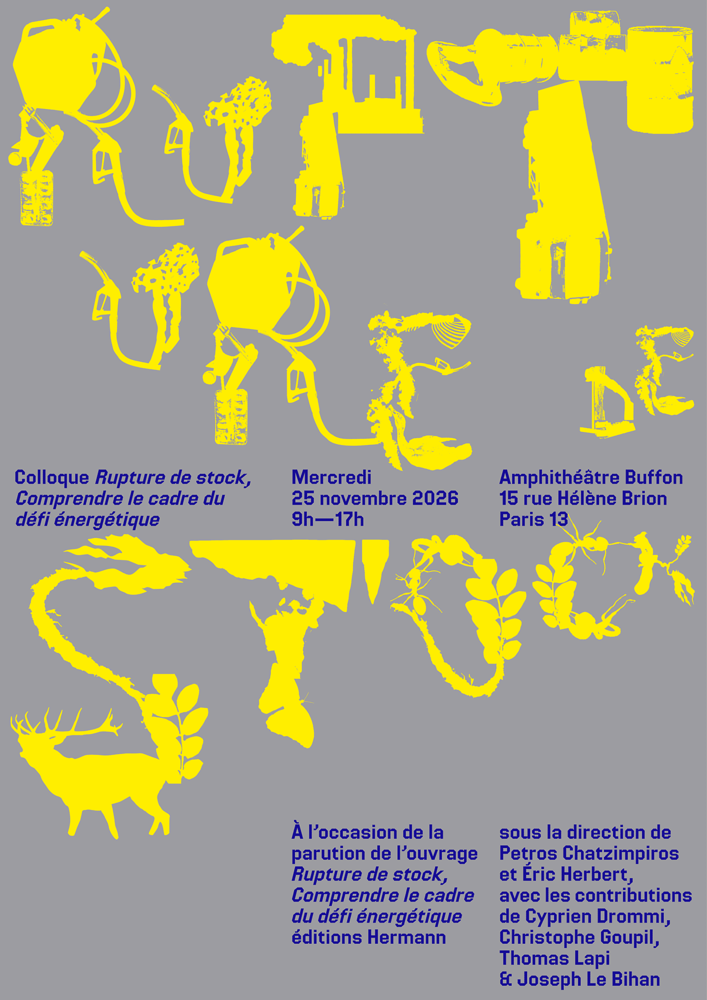

# Rupture de Stock : comprendre le cadre du défi énergétique

{: width="500px"}

Entre **technosolutionnistes qui nient le problème** et **effondristes fatalistes qui nient la solution**, la problématique de la transition énergétique demeure masquée.

À l'occasion de la parution de l'ouvrage [« Rupture de Stock : Comprendre le cadre du défi énergétique »](https://www.editions-hermann.fr/livre/rupture-de-stock-), issu d'un travail collectif du **Laboratoire Interdisciplinaire des Énergies de Demain ([LIED](https://liedlab.net/))**, nous souhaitons replacer la transition énergétique au premier plan, lors d'une journée de rigueur scientifique et de débat constructif.

## Informations pratiques

- 📅 **Date :** mercredi 25 novembre
- 📍 **Lieu :** Université Paris Cité, amphithéâtre Buffon, 15 rue Hélène Brion, 75013 Paris
- 🎟️ **Inscription gratuite et obligatoire :** [s'inscrire](https://rupturedestock.sciencesconf.org/?lang=fr)

## Déroulé

Deux temps forts :

- **La matinée** examine les contraintes : géologiques, géopolitiques, climatiques, jusqu'au désordre des modélisations.
- **L'après-midi** ouvre la prospective, en table ronde avec celles et ceux qui définissent les stratégies nationales, évaluent la faisabilité politique et font vivre le tissu industriel.

Chaque séquence réunit 3 à 4 exposés scientifiques (20 minutes) suivis d'une table ronde.

## Notre ambition

Éclairer le débat public en situant les contraintes physiques, matérielles et systémiques à leur juste place, et déplacer le regard du **mix d'énergie primaire** vers les **usages finaux** et les **irréversibilités sociotechniques** qui façonnent nos trajectoires.

Nous espérons vous voir nombreuses et nombreux à cet événement !

---

## Programme (quasi définitif)

| Horaire | Séquence |
|---|---|
| 08h45 | ☕ Accueil café |
| 09h10 | Introduction et présentation de la journée, *Maximilien Cazayous* (Doyen de la faculté des sciences Université Paris Cité)|

### ☀️ Matin : contraintes

| Horaire | Intervenant·e | Sujet |
|---|---|---|
| 09h25 | **Patrick Brocorens** (chimiste, ASPO France) | Sous la surface des chiffres : anatomie de l'épuisement des hydrocarbures |
| | **Florian Vidal** (politiste, École de guerre) | Contraintes géopolitiques : le retour des empires |
| | **Éric Herbert & Petros Chatzimpiros** (LIED, UPCité) | Chapitre 1 de Rupture de Stock : transition |
| | **Nadia Maïzi** (ingénieure mathématicienne, Mines Paris, CMA) | Contraintes des modélisations |
| 11h00 | | Pause |
| 11h20 |  Table ronde | animée par **Ludo Torbey** ([Osons causer](https://lnkd.in/eWTNd8W7)) |
| 12h30 | | 🍽️ Déjeuner buffet sur place |

### 🌇 Après-midi : prospective

| Horaire | Intervenant·e | Sujet |
|---|---|---|
| 14h00 | **Gilles Ramstein** (paleoclimatologue, CEA, LSCE) | Une transition sous contrainte climatique |
| | **Yanis Chaigneau** (Ministère de la transition) | Stratégies pour gouverner la transition |
| | **Gaël Giraud** (économiste CNRS, LIED) | Une trajectoire net zéro soutenable pour la France et l'Europe|
| | **Cyprien Drommi, Joseph Le Bihan, Thomas Lapi** | Chapitre 2-4 de Rupture de Stock : prospective |
| 15h30 | | Pause |
| 15h50 | Table ronde | animée par **Marina Julienne** (Journal du CNRS) | 
| 17h00 | | Conclusion |
